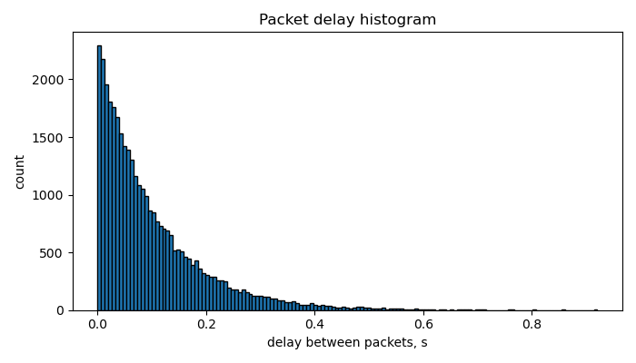
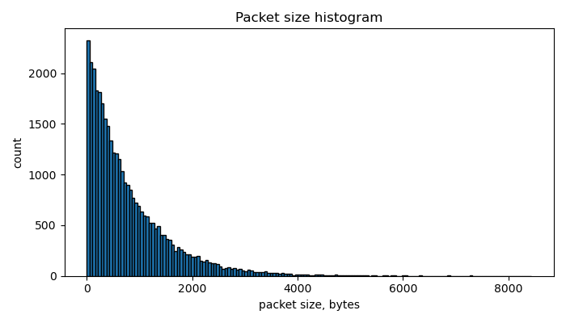

# Packet Traffic Modeling

Моделирование пакетного трафика на C++17 и анализ результатов на Python. Проект формирует последовательность пакетов, рассчитывает характеристики потока и показывает распределения интервалов и размеров пакетов.

## Модели трафика

- **Equal:** пакеты одинакового размера приходят через фиксированный интервал.
- **Poisson:** классический пуассоновский поток с независимыми экспоненциальными интервалами. Размеры пакетов также генерируются по экспоненциальному распределению и округляются до целого числа байт, минимум один байт.

Время моделирования и параметры потока задаются во входном файле. Параметр `seed` позволяет повторить случайную реализацию.

## Как устроен проект

C++ формирует время прихода и размер каждого пакета, сохраняет их в CSV. Python рассчитывает количество пакетов, средний размер, средний битрейт и средний интервал между пакетами, затем строит две гистограммы.

Исходники генератора находятся в `cpp/`, анализ данных в `python/`, примеры параметров в `cpp/examples/`.

## Результаты

Пример пуассоновского потока: время моделирования 3600 с, средний интервал 0,1 с, средний размер пакета 800 байт, `seed = 42`.

Получено 35 793 пакета. Средний интервал составил 0,1006 с, средний размер 801,02 байта, средний битрейт 63,71 кбит/с.

### Интервалы между пакетами

Короткие интервалы встречаются чаще, длинные реже.

### Размеры пакетов

Большую часть потока составляют небольшие пакеты. Вероятность больших размеров постепенно уменьшается.

Параметры примера сохранены в [poisson_results.txt](cpp/examples/poisson_results.txt), рассчитанные характеристики в [statistics.txt](docs/results/statistics.txt).
